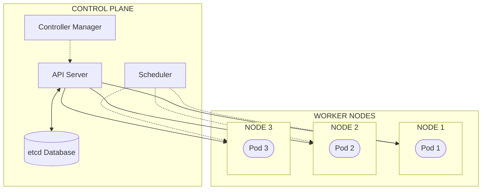
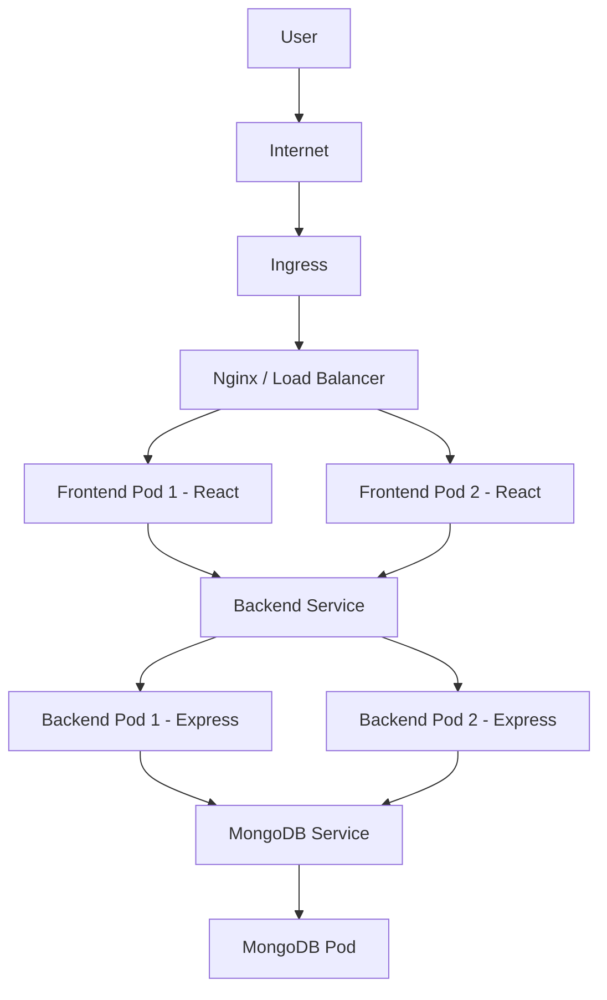

## kubernetes
 - contains orchestration platform that automates deployment , scaling , networking , self healing and life cycle management of containerized applications across a cluster of machines.
## Architecture

## worker Node Components
  ## kubelet 
   - agent running on each node, talks to API server from node. It creates monitor pods
  ## Container Runtime
  - runs containers example: docker
  ## kube proxy
  - handles networking, route traffic
  - Pod-> express
  ## pod
  - smallest deployable unit , supports multiple container
  - Pod->App Container.logging

## what happens when pod crashes?
- replica set recreates
## what happens when node crashes?
- scheduler moves pods to healthy pods
## how does service find pods?
- labels + selectors
## why deployment?
- scaling
- Rollback
- Rolling updates
## how kubernetes achieve zero downtime?
- rolling updates
- readiness probes
## Ingress  
- network traffic, management to the services in a kubernetes cluster
- acting as an API object that manages external access to service within the clusters

## Deployment Architecture
- React, Express, MongodB database
- Each component is containerized using docker
- React is served through Nginx
- Express exposes REST APIs and Socket.IO
- MongoDB stores activity data
- Jenkins acts as the CI/CD tool
- when code is pushed to Github, a webhook triggers jenkins to run tests,build docker images and push them to docker Hub.
- Kubernetes deploys containers using deployments and services
- frontend and backend run multiple replicas for high availability while service provide stable networking
- Ingress acts as a reverse proxy and SSL termination layer
- Kubernetes handles scaling, self healing and rolling updates, ensuring zero downtime deployments

## kubernetes and why not
- Docker compose: Single machine
- Kubernetes: cluster, multiple nodes, auto healing , auto scaling , rolling updates
## why not deploy containers directly?
- Containers are unmanaged
- Pods provide networking, storage, lifecycle , health checks
- Kubernetes manages pods
## Github Webhook
- webhook is an event driven HTTP callback where github automatically sends a POST request to jenkins whenever a repository event such as code push occurs triggering the CI/CD pipeline without pooling
## Deployment Architecture

